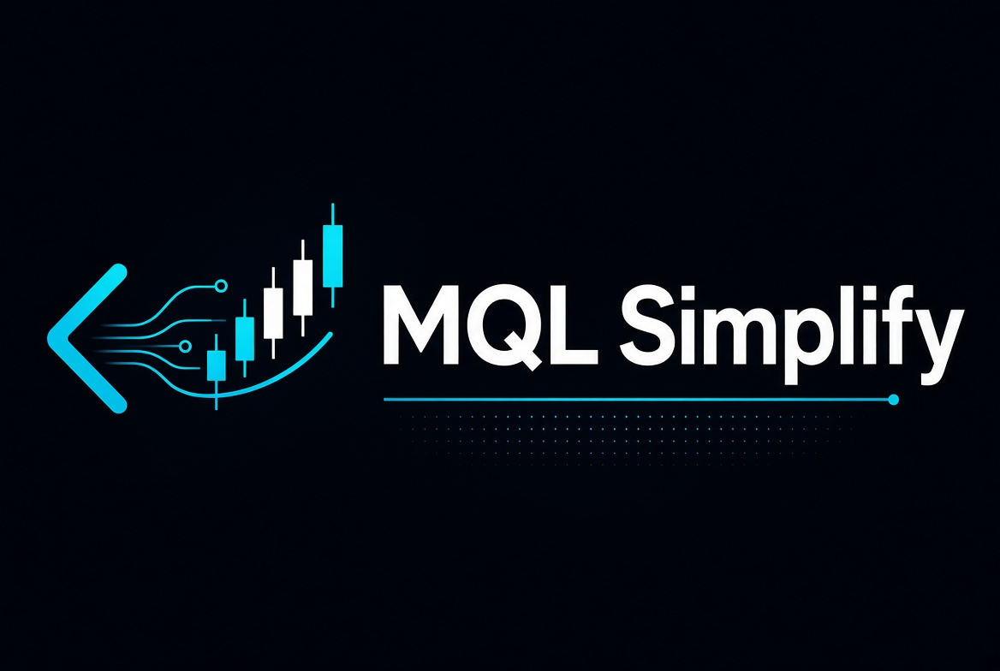

# MQL Simplify

<p align="center">
  
</p>

Biblioteca de classes e funções **MQL5** (MetaTrader 5) que simplifica tarefas comuns de EAs, indicadores e scripts: envio de ordens, posições, histórico de negócios, limites de risco, objetos gráficos, horários do servidor e validação de inputs.

> **English summary** at the end of this file.

- Só headers (`.mqh`): não é preciso compilar nada à parte nem usar DLL.
- Testada com **MetaEditor build 6272**: todos os headers compilam com 0 erros e 0 avisos.
- Os headers marcados como *trade-free* podem ser usados em indicadores e em produtos para o Market que não podem operar, porque não incluem `Trade.mqh`, `CTrade`, `OrderSend` nem `MessageBox`.

## Índice
- [Instalação](#instalação)
- [Módulos](#módulos)
- [Exemplos](#exemplos)
- [Compilar e testar](#compilar-e-testar)
- [Changelog](#changelog)
- [Contribuindo](#contribuindo)
- [English](#english)

## Instalação

### Opção 1: copiar para `MQL5\Include`
1. Na MetaTrader 5, abra **Arquivo → Abrir pasta de dados**.
2. Copie o repositório para `MQL5\Include\mqlsimplify\`.
3. Inclua os headers com sinais de menor e maior:
   ```cpp
   #include <mqlsimplify/SendOrders.mqh>
   ```

### Opção 2: submódulo git (recomendado em projetos versionados)
```bash
git submodule add https://github.com/HommaTech/mql-simplify.git src/Lib/mql-simplify
git submodule update --init
```
Depois inclua os headers pelo caminho relativo:
```cpp
#include "Lib/mql-simplify/DealMath.mqh"
```
Para atualizar: `git -C src/Lib/mql-simplify pull origin master`. Em seguida, faça commit do novo ponteiro do submódulo.

### Opção 3: npm (legado)
```bash
npm install mql-simplify --save
```
```cpp
#include "node_modules/mql-simplify/Graphic.mqh"
```
`compile.ps1` (Windows/PowerShell) compila um arquivo com `metaeditor64`. Para usá-lo, ajuste o caminho do parâmetro `$MQLFile` para a pasta `MQL5` do seu terminal.

## Módulos

Legenda: **TF** = *trade-free*, ou seja, pode ser usado em indicadores e não envia ordens.

| Header | Classes / funções | TF | Para que serve |
|---|---|:-:|---|
| `SendOrders.mqh` | `CSendOrders` | | Ordens a mercado e pendentes com SL/TP em pontos ou em preço. Antes de enviar, verifica o volume e a margem livre e escolhe o modo de preenchimento aceito pelo símbolo. |
| `Positions.mqh` | `CPositions` | | Conta, seleciona e fecha posições por símbolo e magic. |
| `Orders.mqh` | `COrders` | | Pendentes: conta e apaga. |
| `Operations.mqh` | `COperations` | | Lucro acumulado, número de trades e ticket do n-ésimo negócio passado. |
| `Strategies.mqh` | `CStrategies`, `SimplifyNormalizeVolume`, `SimplifyPartialLevelReached` | | Trailing stop, breakeven, fechamento parcial, martingale e stops em posições manuais. |
| `Limitations.mqh` | `CLimitations` | ✓ | Limites diários de lucro, perda, volume e tempo operado. |
| `InputCheck.mqh` | `CInputCheck` | ✓ | Valida inputs (volume, horários) e mostra a mensagem ao usuário. |
| `DealMath.mqh` | `SimplifyDealResult`, `SimplifyIsTradeDeal`, `SimplifyHistoryProfit`, `SimplifyFloatingProfit` | ✓ | Resultado de negócios (lucro + swap + comissão + taxa) e lucro flutuante. |
| `DayClock.mqh` | `CDayClock` | ✓ | Início do "dia de trading" no horário do servidor, com hora de virada configurável. |
| `HistoryReader.mqh` | `CHistoryReader`, `CDealListener` | ✓ | Leitura incremental do histórico, com limite de negócios e de milissegundos por chamada (não trava o thread do indicador). |
| `HistoryMetrics.mqh` | `CDrawdown`, `CTradeStats`, `CPositionCosts` | ✓ | Drawdown pico-vale, fator de lucro, expectativa, taxa de acerto e custos de entrada por posição. |
| `DealGroups.mqh` | `CDealGroups` | ✓ | Estatísticas agrupadas por magic, por nome de magic (`"1001=Trend;1002=Grid"`) ou por símbolo. |
| `Regression.mqh` | `SimplifyLinReg`, `SimplifyLinRegLast`, `SimplifyLinRegUpper/Lower`, `SimplifyLinRegTrendScore` | ✓ | Regressão linear (mínimos quadrados) numa janela de preços: inclinação, valor na última barra, desvio-padrão dos resíduos (canal), R² e inclinação normalizada pela volatilidade. Funções puras. |
| `RiskSizing.mqh` | `SimplifyLotForRisk`, `SimplifyFloorVolume`, `SimplifyLossPerLot`, `SimplifyMinStopDistance`, `SimplifyRoundToTick` | ✓ | Lote pelo dinheiro em risco e distância do stop, arredondado **para baixo** ao passo e limitado ao mínimo/máximo do símbolo; distância mínima de SL/TP (stops level e freeze level). Funções puras. |
| `Messages.mqh` | `SimplifyMessageBox` | ✓ | `MessageBox` em EAs e scripts; `Alert` em indicadores, onde `MessageBox` é proibido. |
| `Graphic.mqh` | `CHorizontalLine`, `CRetangle`, `CLabel`, `CEdit`, `CButton`, `CDropdown` | ✓ | Objetos de gráfico com criação, mudança de estado e destruição. |
| `CandleInfos.mqh` | `CCandleInfos` | ✓ | Nova vela, tamanho e direção. |
| `SymbolInfo.mqh` | `CSymbolInfo` | ✓ | Propriedades do símbolo e tempo em operação. |
| `TimeManipulation.mqh` | `CTimeManipulation` | ✓ | Conversão `"HH:MM:SS"` ↔ segundos e janelas de horário. |
| `Storage.mqh` | `CLocalStorage` | ✓ | Estado chave/valor persistido em arquivo. |
| `Math.mqh`, `Utils.mqh`, `NewTypes.mqh` | `CMath`, `CUtils`, enums | ✓* | Utilidades e tipos compartilhados (*`Utils.mqh` inclui `Trade.mqh`). |

A documentação de cada módulo está em [`docs/`](docs/README.md): `DealMath.md`, `HistoryMetrics.md`, `Messages.md`, `SendOrders.md` e outros.

## Exemplos

**Ordem a mercado com SL/TP em pontos**
```cpp
#include <mqlsimplify/SendOrders.mqh>
CSendOrders so(_Symbol, 123456, 0.10, 400, 200);   // símbolo, magic, volume, TP e SL em pontos
void OnTick() {
  bool req[] = {true};             // todas as condições do setup precisam ser true
  so.AtMarketPoints(req, BUY);     // não envia nada se o volume for inválido ou a margem livre não bastar
}
```

**Resultado do dia, sem funções de trade (serve em indicadores)**
```cpp
#include "Lib/mql-simplify/DayClock.mqh"
#include "Lib/mql-simplify/DealMath.mqh"
CDayClock clock;             // virada às 00:00 do servidor
double hoje = SimplifyHistoryProfit(clock.Today(), TimeTradeServer()) + SimplifyFloatingProfit();
```

**Histórico incremental com limite de trabalho**
```cpp
#include "Lib/mql-simplify/HistoryReader.mqh"
class CMeuOuvinte : public CDealListener {
public:
  virtual void OnDeal(ulong ticket) { /* acumula */ }
};
CHistoryReader reader; CMeuOuvinte ouvinte;
int OnInit() { reader.Configure(500, 5); return INIT_SUCCEEDED; } // 500 negócios ou 5 ms por chamada
void OnTimer() { reader.Read(GetPointer(ouvinte)); if(reader.IsLoading()) return; /* pronto */ }
```

**Drawdown e estatísticas por magic**
```cpp
#include "Lib/mql-simplify/DealGroups.mqh"
CDealGroups groups;
groups.Configure(DEAL_GROUP_NAME, "1001=Trend;1002=Grid");
string chave = groups.KeyFor(1001, _Symbol);   // "Trend"
CDrawdown dd; dd.Add(+120); dd.Add(-80);       // dd.MaxDrawdown() == 80
```

**Mensagem segura em qualquer tipo de programa**
```cpp
#include "Lib/mql-simplify/Messages.mqh"
SimplifyMessageBox("Volume inválido");   // Alert() em indicador, MessageBox() em EA/script
```

## Compilar e testar

### Windows
Abra o arquivo no MetaEditor e pressione F7. Também é possível compilar pela linha de comando:
```
metaeditor64.exe /compile:"MQL5\Experts\Meu.mq5" /log:"build.log" /inc:"C:\...\MQL5"
```
O resultado esperado no log é `Result: 0 errors, 0 warnings`.

### Linux (Debian/Ubuntu e Fedora) com Wine
1. Instale o Wine:
   - Debian/Ubuntu: `sudo apt install winehq-devel`, com o repositório da WineHQ configurado.
   - Fedora: `sudo dnf install wine`.
2. Instale a MT5 num prefixo próprio. Por exemplo, `WINEPREFIX=~/.wine-mt5 wine mt5setup.exe`. Também funciona copiar uma pasta *portable* para `drive_c/MT5`.
3. Copie ou crie um link da biblioteca em `drive_c/MT5/MQL5/Include/mqlsimplify`.
4. Compile sem tela, usando um X virtual:
   ```bash
   Xvfb :77 -screen 0 1280x1024x24 & export DISPLAY=:77
   cd ~/.wine-mt5/drive_c/MT5
   WINEPREFIX=~/.wine-mt5 wine MetaEditor64.exe /portable \
     /compile:'C:\MT5\MQL5\Scripts\mqlsimplify\tests\TestHistory.mq5' /log:'C:\MT5\build.log'
   iconv -f utf-16 -t utf-8 build.log | grep Result
   ```
   O log do MetaEditor é gravado em UTF-16. Sob Wine, o MetaEditor às vezes encerra sem gravar o log; nesse caso, basta repetir o comando.

### Testes (`tests/`)
| Arquivo | Tipo | O que verifica |
|---|---|---|
| `TradeFreeHeaders.mq5` | indicador | Os headers *trade-free* compilam num indicador sem `Trade.mqh` e sem `MessageBox`. |
| `TestDealGroups.mq5` | script | Parsing do mapa de magics, chaves e ordenação dos grupos. |
| `TestHistory.mq5` | script | DayClock, HistoryReader e HistoryMetrics. |
| `TestRegressionSizing.mq5` | script | Regressão (retas conhecidas, resíduos, janelas inválidas) e cálculo de lote (passo, mínimo, máximo, stop level). |
| `TestReviewFixes.mq5` | script | Entradas inválidas que antes paravam o programa (fora do intervalo do array, ponteiro inválido). |

Os scripts não precisam de conta. Rode-os no terminal (arraste o script para o gráfico). Cada um grava `MQL5\Files\mqlsimplify_*_results.txt`, cuja última linha é `RESULT PASS: N passed, 0 failed`.

**Critério para aceitar um PR:** todos os arquivos de `tests/` compilam com 0/0 e todos os scripts terminam em `RESULT PASS`.

## Changelog

Veja [CHANGELOG.md](CHANGELOG.md). Resumo da próxima versão: módulos novos DayClock, HistoryReader, HistoryMetrics, DealGroups, DealMath e Messages; headers em UTF-8; verificações de volume, margem e preenchimento antes das ordens; correções para o build 6272.

## Contribuindo
1. Crie um branch a partir de `master` (`fix/...`, `feat/...` ou `docs/...`) e abra um PR pequeno, com um assunto por PR.
2. Mantenha a API pública. Mudanças de comportamento precisam estar descritas no PR e no CHANGELOG.
3. Codificação dos arquivos: **UTF-8 com BOM, quebra de linha LF**. O `.gitattributes` aplica o LF.
4. Indentação de 2 espaços. Comentários em inglês.
5. Headers *trade-free* não podem incluir `Trade.mqh` nem chamar `OrderSend` ou `MessageBox`. Use `SimplifyMessageBox`.
6. Use o horário do servidor (`TimeTradeServer()`) e não `TimeLocal()`.
7. Adicione ou atualize um teste em `tests/` e compile com 0 erros e 0 avisos.

---

## English

**MQL Simplify** is a header-only MQL5 library for MetaTrader 5. It covers orders, positions, deal history, daily risk limits, chart objects, server-time days and input validation. Every header compiles with 0 errors and 0 warnings on MetaEditor build 6272.

- **Install:** copy the repository to `MQL5\Include\mqlsimplify\` and use `#include <mqlsimplify/X.mqh>`, or add it as a git submodule and include it by relative path.
- **Trade-free headers** (marked ✓ in the table above) do not include `Trade.mqh` or call `OrderSend`/`MessageBox`, so they are safe in indicators and in Market products that must not trade.
- **Tests:** the files in `tests/` must compile 0/0, and each script must end with `RESULT PASS`. On Linux, compile with MetaEditor under Wine as shown above.
- **Contributing:** use small PRs from `master`, keep the public API, store files as UTF-8 with BOM and LF, and use server time.
